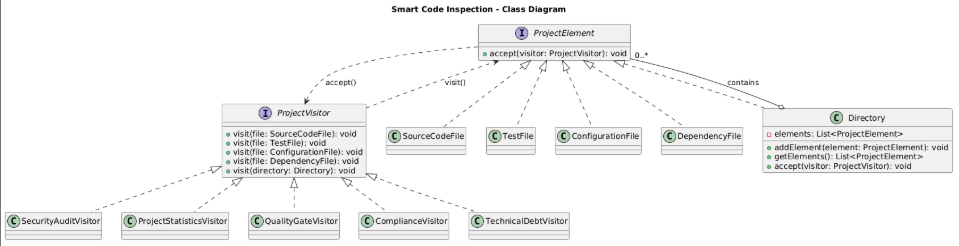
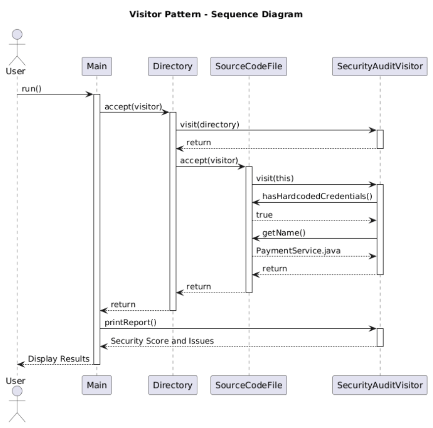

# Smart Code Inspection & Compliance Engine

## Overview

This project is a Java application that analyzes software projects using the Visitor Design Pattern.

It performs security audits, calculates project statistics, checks release readiness, verifies compliance rules, and identifies technical debt.

The project was developed as Assignment 6 for Software Design Patterns.

## Technologies

- Java 17+
- Maven
- JUnit 5
- Visitor Design Pattern
- PlantUML

## Features

The application includes five visitors:

1. **SecurityAuditVisitor** - detects security risks and calculates a security score.
2. **ProjectStatisticsVisitor** - calculates files, lines of code, dependencies, average complexity, and test/source ratio.
3. **QualityGateVisitor** - checks whether a project is ready for release.
4. **ComplianceVisitor** - checks development rules and compliance violations.
5. **TechnicalDebtVisitor** - detects high complexity, large files, failing tests, and low test coverage.

## Project Elements

All project elements implement the `ProjectElement` interface:

- SourceCodeFile
- TestFile
- ConfigurationFile
- DependencyFile
- Directory

Each element implements `accept(ProjectVisitor visitor)`.

## Demo Scenarios

### Risky Project

The risky fintech project contains security issues, high complexity, and compliance violations.

Expected results:

- Security Score: 50/100
- Quality Gate: FAILED
- Compliance: NON-COMPLIANT
- Technical Debt: 15

### Safe Project

The safe fintech project follows the required quality and security rules.

Expected results:

- Security Score: 100/100
- Quality Gate: PASSED
- Compliance: COMPLIANT
- Technical Debt: 0

## How to Run

Open the project in IntelliJ IDEA and load the Maven dependencies.

Run:

- `com.aruzh.demo.Main` for the risky project.
- `com.aruzh.demo.SafeDemo` for the safe project.

## Testing

The project includes 14 JUnit 5 tests covering security, statistics, quality gates, compliance, technical debt, nested directories, and edge cases.

All 14 tests passed during development.

## UML Diagrams

### Class Diagram

[View PlantUML Source](docs/class-diagram.puml)

### Sequence Diagram

[View PlantUML Source](docs/sequence-diagram.puml)

- [Class Diagram](docs/class-diagram.puml)
- [Sequence Diagram](docs/sequence-diagram.puml)

## Visitor Pattern Questions

### 1. What problem does Visitor solve in this project?

The Visitor Pattern separates project elements from the operations performed on them. It allows us to add new inspections without modifying existing element classes.

### 2. Where are Element and Visitor?

`ProjectElement` is the Element interface, implemented by SourceCodeFile, TestFile, ConfigurationFile, DependencyFile, and Directory.

`ProjectVisitor` is the Visitor interface, implemented by our five concrete Visitors.

### 3. What is double dispatch?

Double dispatch means that the operation depends on both the element type and the visitor.

First, the element receives a visitor through `accept()`. Then it calls `visitor.visit(this)`, selecting the correct visit method.

### 4. Why not put all operations directly inside Element classes?

It would mix data with security, statistics, quality, and compliance logic. The classes would become harder to maintain and violate the Single Responsibility Principle.

### 5. Is it easier to add a new Visitor or a new Element? Why?

Adding a new Visitor is easier because we only need to implement the ProjectVisitor interface.

Adding a new Element requires updating ProjectVisitor and all existing concrete Visitors.

### 6. When would Visitor be a bad choice?

Visitor is not a good choice when new element types are added frequently, because every new element requires changes to all Visitors.

### 7. How is Visitor different from Strategy?

Strategy selects one interchangeable algorithm to perform a task.

Visitor performs different operations on a structure of different element types using double dispatch.

### 8. Which SOLID principles can you identify?

Single Responsibility Principle: Element classes store data, while Visitors perform inspections.

Open/Closed Principle: New operations can be added through new Visitors without modifying existing Elements.

Dependency Inversion Principle: Elements depend on the ProjectVisitor abstraction rather than specific Visitor implementations.

## Visitor Limitation Challenge

### What happens if we add DatabaseMigrationFile?

We would need to:

1. Create a new DatabaseMigrationFile class implementing ProjectElement.
2. Add `visit(DatabaseMigrationFile file)` to ProjectVisitor.
3. Implement the new visit method in all five existing Visitors.
4. Update the demo and tests if the new element is used.

This demonstrates the main limitation of the Visitor Pattern: adding new operations is easy, but adding new element types requires modifying the Visitor interface and its implementations.
